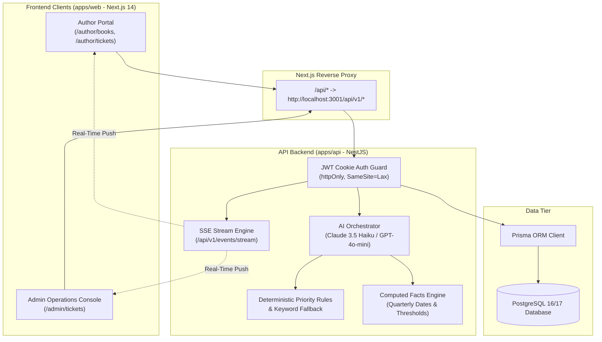

# BookLeaf Author Support & Communication Portal

> **Confidential Hiring Take-Home Assignment**  
> End-to-end full-stack web application with AI-assisted triage, priority enforcement, automated response drafting, and real-time streaming operations desk for **BookLeaf Publishing**.

---

## 1. Executive Summary & Capabilities

BookLeaf Publishing is a leading self-publishing house (operating across India and the US) processing over 1,200 titles per month across a 22,000+ title catalog. This portal solves author inquiry backlogs and inconsistent replies by providing two dedicated interfaces:

1. **Author Portal (`/author/*`):**
   - **My Books:** Live published titles catalog, production stage stepper (9 stages from Manuscript to Distribution), quarterly royalty breakdown (earned, paid, and pending in Indian Rupee format), and rollover alerts for pending balances below ₹1,000.
   - **New Query:** Support submission linking specific book metadata, character counters, file attachment dropzone with client-side validation, and sticky KB guidance.
   - **Ticket Thread:** Chat-style correspondence with "Team BookLeaf" support representatives, day separators, and real-time reply updates.
2. **Admin Operations Desk (`/admin/*`):**
   - **Urgency-Sorted Queue:** Triage table ordered by urgency (unresolved first, Critical to Low priority, oldest first) with SLA breach timers, category tags with icons, assignee filters, and live ticket arrival banners.
   - **AI Response Assistant:** On-demand response drafting incorporating live book numbers and computed payout dates, editable response textarea, verification flags, and manual fallback templates.
   - **Triage Controls & Overrides:** Category and priority selection showing AI suggestions and persisting audited admin overrides.
   - **Internal Staff Notes:** Private staff commentary strictly shielded from author endpoints.
   - **AI Telemetry Card:** Live dashboard tracking daily LLM calls, token usage, estimated costs, and failure rates.

---

## 2. Architecture Diagram



---

## 3. Tech Stack

| Layer | Choice | Rationale |
|---|---|---|
| **Monorepo** | npm workspaces (`apps/api`, `apps/web`, `docs/`) | Single repository coordination, zero package duplication. |
| **Backend** | NestJS (TypeScript), REST, `@nestjs/swagger`, `helmet`, `@nestjs/throttler` | Enterprise modularity, strict DTO validation, uniform error envelope. |
| **Database** | PostgreSQL 16/17 + Prisma ORM | Relational integrity, composite indexing, immutable audit logs. |
| **Frontend** | Next.js 14 App Router, TypeScript, Tailwind CSS | High-performance server rendering, same-origin proxy rewrites. |
| **Design System** | shadcn/ui, React Bits, GSAP motion orchestration | "Editorial Publishing House" aesthetic: Fraunces serif, Jakarta Sans, JetBrains Mono. |
| **Real-Time** | Server-Sent Events (SSE) with 5s polling fallback | Lightweight unidirectional event stream; no WebSocket overhead. |
| **AI Integration** | Provider-agnostic interface (Anthropic Claude 3.5 Haiku default, OpenAI GPT-4o-mini secondary) | Sub-second latency, structured JSON schemas, versioned draft caching, circuit breakers. |

---

## 4. Quickstart & Local Setup

### Prerequisites
- Node.js `v18.18+` or `v20+`
- PostgreSQL instance running locally or via Docker

### 1. Clone & Configure Environment
```bash
git clone <repository_url>
cd BookLeaf
cp .env.example .env
```
*(Verify `.env` has your `DATABASE_URL` and optional `ANTHROPIC_API_KEY` or `OPENAI_API_KEY`).*

### 2. Start PostgreSQL via Docker (Optional)
```bash
docker compose up -d postgres
```

### 3. Run Database Migrations & Seed
```bash
npm run prisma:generate --workspace=apps/api
npm run prisma:migrate --workspace=apps/api
npm run prisma:seed --workspace=apps/api
```

### 4. Run Both Applications
In separate terminals or concurrently:
```bash
# Terminal 1: Backend API (port 3001)
npm run dev --workspace=apps/api

# Terminal 2: Web Portal (port 3000)
npm run dev --workspace=apps/web
```
- Open **Web Application:** `http://localhost:3000`
- Open **Swagger API Documentation:** `http://localhost:3001/api/docs`
- Health Check: `http://localhost:3001/api/v1/health`

---

## 5. Demo Credentials

All accounts are pre-seeded and idempotent. A 1-click credential selector is available directly on the login screen.

### Operations Staff (Admins)
| Role | Email | Password | Responsibility |
|---|---|---|---|
| **Support Lead** | `admin@bookleaf.test` | `Admin@123` | Queue supervisor, triage overrides, AI usage monitoring |
| **Operations Desk** | `ops@bookleaf.test` | `Admin@123` | Direct author correspondence, response drafting |

### Authors (Sample from 10 Seeded Accounts)
| Author Code | Author Name | Email | Password | Scenario / Edge Case |
|---|---|---|---|---|
| `AUTH001` | Priya Sharma | `priya.sharma@email.com` | `Author@123` | 2 published books, ₹3,570 pending royalty |
| `AUTH002` | Rohit Kapoor | `rohit.kapoor@email.com` | `Author@123` | 2 books (*Code & Karma*, *Startup Sutra*), ₹7,744 pending |
| `AUTH003` | Ananya Reddy | `ananya.reddy@email.com` | `Author@123` | 1 book (*Between Two Temples*), 0 payouts to date |
| `AUTH004` | Vikram Joshi | `vikram.joshi@email.com` | `Author@123` | 2 books (*Debugging Life*, *The Last Monsoon*), ₹3,350 pending |
| `AUTH005` | Meera Nair | `meera.nair@email.com` | `Author@123` | 2 books (*Cardamom & Chaos*, *Letters from Lakshadweep*) |
| `AUTH006` | Arjun Malhotra | `arjun.malhotra@email.com` | `Author@123` | 1 book (*Turban Tales*), ₹2,464 pending |
| `AUTH007` | Sneha Kulkarni | `sneha.kulkarni@email.com` | `Author@123` | 3 books, title in production (*Midnight in Mysore* - Cover Design) |
| `AUTH008` | Farhan Sheikh | `farhan.sheikh@email.com` | `Author@123` | 1 book (*Ghazal of the Forgotten*), fully paid to date |
| `AUTH009` | Kavita Deshmukh | `kavita.deshmukh@email.com` | `Author@123` | ₹850 pending royalty (below ₹1,000 threshold - rolls over) |
| `AUTH010` | Diya Chatterjee | `diya.chatterjee@email.com` | `Author@123` | 2 books (*Durga’s Daughters*, *Howrah Nights*) |

---

## 6. Testing & Evaluation Commands

```bash
# 1. Run full E2E security, multi-tenant isolation, and secret leak tests:
npm run test:e2e --workspace=apps/api

# 2. Run unit tests for royalty cycle math and deterministic priority safety net:
npx jest src/ai/context/royalty-cycle.spec.ts src/ai/heuristics/priority-rules.spec.ts --workspace=apps/api

# 3. Run AI classification evaluation suite (21 labelled ground-truth queries):
npm run eval:classify --workspace=apps/api

# 4. Verify Next.js production build:
npm run build --workspace=apps/web
```

---

## 7. Deployment Configuration

### API Service (Render / Railway / Docker)
A multi-stage production Dockerfile is included at `apps/api/Dockerfile`:
- Exposes port `3001`.
- Automatically executes Prisma Client generation during build stage.
- Prunes development dependencies in the runner stage.
- Configured via environment variables: `DATABASE_URL`, `JWT_SECRET`, `COOKIE_SECRET`, `CORS_ORIGIN`, `AI_PROVIDER`, `AI_MODEL`, `ANTHROPIC_API_KEY`.

### Web Client (Vercel)
- Configured as a Next.js App Router project located at root workspace `apps/web`.
- In production with split domains, set `NEXT_PUBLIC_API_URL` to route requests directly to the deployed backend URL, with `cors` and cookie credentials enabled.

---

## 8. Known Limitations & What I'd Improve in Production

1. **Distributed Job Queue:** Transition in-process `setImmediate` triage jobs to **BullMQ** with Redis to handle sudden bursts of 10,000+ simultaneous queries with dead-letter queue retry policies.
2. **Cloud Object Storage:** Replace the attachment metadata placeholder with presigned URL uploads directly to **AWS S3** or **Cloudflare R2** accompanied by asynchronous antivirus scanning.
3. **Redis Pub/Sub SSE Scaling:** Replace in-memory RxJS event subjects with **Redis Pub/Sub** to allow seamless multi-node backend scaling.
4. **Email & WhatsApp Integration:** Integrate transactional notification webhooks (SendGrid or Resend) to alert authors when an operations specialist replies.
5. **Human-in-the-Loop AI Feedback:** Add thumbs-up/thumbs-down ratings and diff logging on AI-drafted responses to automatically collect fine-tuning and prompt-improvement datasets.
