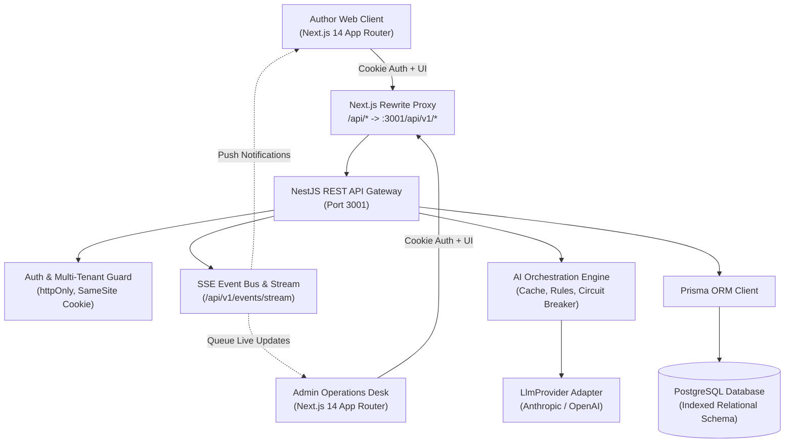
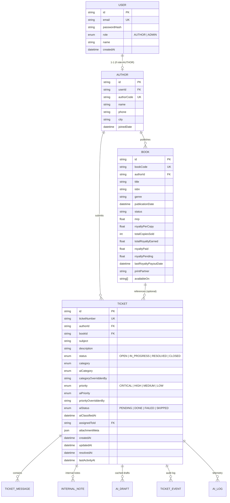

# BookLeaf Portal — System Architecture & Engineering Blueprint

## 1. High-Level Architecture Overview

The BookLeaf Author Support & Communication Portal is built as an enterprise-grade monorepo divided into modular services:
- **`apps/api` (Backend):** NestJS REST service with TypeScript, Prisma ORM, PostgreSQL, `@nestjs/swagger`, `class-validator`, rate limiting via `@nestjs/throttler`, security via `helmet`, and JWT cookie authentication.
- **`apps/web` (Frontend):** Next.js 14 App Router, TypeScript, Tailwind CSS, shadcn/ui primitives, React Bits animated components, and GSAP motion orchestration.
- **Real-Time Layer:** Server-Sent Events (SSE) stream (`/api/v1/events/stream`) with automatic 5-second polling fallback.
- **AI Triage Engine:** Provider-agnostic orchestration (`LlmProvider` interface) supporting Anthropic Claude 3.5 Haiku and OpenAI GPT-4o-mini, guarded by deterministic rule safety nets, prompt injection defenses, versioned caching, and circuit breakers.



---

## 2. Monorepo Structure

```
bookleaf-portal/
├─ apps/
│  ├─ api/
│  │  ├─ prisma/
│  │  │  ├─ schema.prisma
│  │  │  ├─ migrations/
│  │  │  ├─ seed.ts
│  │  │  └─ data/bookleaf_sample_data.json
│  │  └─ src/
│  │     ├─ main.ts, app.module.ts
│  │     ├─ common/ (guards, decorators, filters, interceptors, error codes)
│  │     ├─ config/ (zod environment schema validation)
│  │     ├─ auth/  users/  authors/  books/  tickets/  admin/  events/
│  │     ├─ ai/
│  │     │  ├─ ai.module.ts, ai.service.ts
│  │     │  ├─ providers/ (llm-provider.interface.ts, anthropic.provider.ts, openai.provider.ts)
│  │     │  ├─ prompts/ (classify.prompt.ts, draft.prompt.ts)
│  │     │  ├─ knowledge-base/ (kb.ts, kb.retriever.ts)
│  │     │  ├─ context/ (author-context.builder.ts, royalty-cycle.ts)
│  │     │  ├─ heuristics/ (keyword-classifier.ts, priority-rules.ts)
│  │     │  └─ schemas/ (zod LLM schemas)
│  │     └─ prisma/ (PrismaService)
│  └─ web/
│     ├─ app/ ((auth)/login, author/*, admin/*, layout.tsx, globals.css)
│     ├─ components/ (brand/, reactbits/, shared/, author/, admin/)
│     └─ lib/ (api.ts, gsap.ts, motion.ts, useTicketStream.ts, utils.ts)
├─ docs/ (ARCHITECTURE.md, AI_INTEGRATION.md, API.md, ASSUMPTIONS.md, FRONTEND_DESIGN.md, WRITEUP.md)
├─ docker-compose.yml
├─ package.json
└─ .env.example
```

---

## 3. Data Schema & Audit Model

### Entity-Relationship Diagram



### Security & Privacy Rules Enforced in Query Layer
1. **Tenant Isolation:** Authors can strictly access only records where `authorId === currentAuthor.id`. Accessing another author's book or ticket returns `404 Not Found` (never `403 Forbidden`) to eliminate resource enumeration vectors.
2. **Internal Note Shielding:** Author endpoints serialize queries explicitly omitting `internalNotes` and AI internal scores. Unit and e2e security tests assert this at the test runner level.
3. **No Raw 500s:** Global `AllExceptionsFilter` converts database, validation, and third-party API errors into the uniform error envelope `{ error: { code, message, details?, requestId } }`.

---

## 4. Real-Time Architecture & Scaling Strategy

### Current In-Memory Event Bus
- Implemented in `apps/api/src/events/events.service.ts` using RxJS Subjects.
- Authentication occurs via the `bookleaf_token` httpOnly cookie passed on connection handshake.
- Role-based filtering: Authors receive events scoped exclusively to their own tickets; Admins receive global queue events.
- 25-second keep-alive heartbeat comment prevents intermediate reverse proxies from dropping idle connections.
- Frontend hook `useTicketStream` automatically falls back to 5-second polling if the SSE stream disconnects.

### Production Horizontal Scaling Roadmap
When scaling to multi-instance container clusters (e.g., Render/Railway/Kubernetes):
1. **Redis Pub/Sub Layer:** Replace the in-process RxJS Subject with a Redis Pub/Sub channel (`bookleaf:events`). Every API instance publishes events to Redis and broadcasts incoming channel events to its locally connected SSE clients.
2. **PostgreSQL `LISTEN / NOTIFY` Alternative:** For environments without Redis, native Postgres notification channels can be consumed via Prisma client connections.
3. **Sticky Sessions or WebSocket Alternative:** Not required for SSE since SSE is a unidirectional HTTP GET response stream.
